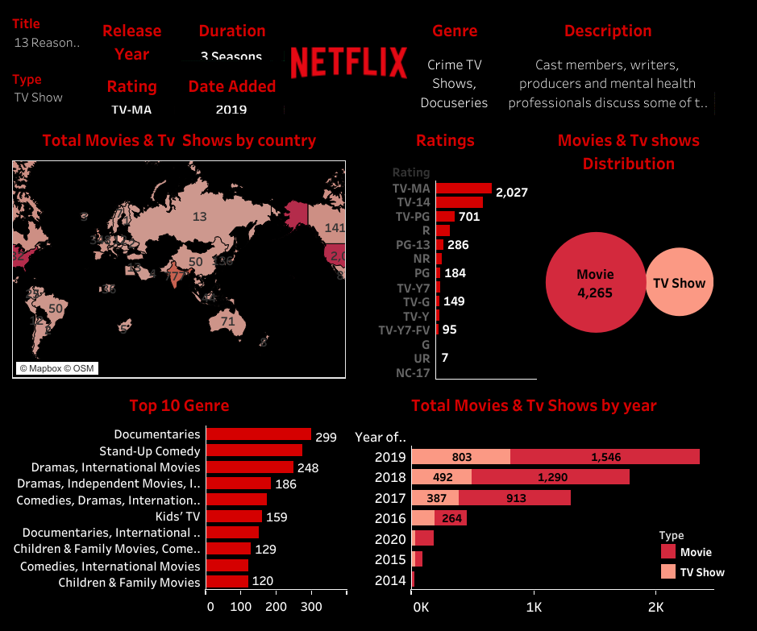

# Netflix Content Analysis Dashboard

An interactive Tableau dashboard that explores the Netflix catalog by content type, genre, rating, country and the year titles were added.

**[View the live dashboard on Tableau Public](https://public.tableau.com/app/profile/piyush.gupta2451/viz/Netflix_Dashboard_17953323260200/NETFLIX)**

## Dataset

`netflix_titles.csv` has 6,234 titles (4,265 movies and 1,969 TV shows) with these columns: type, title, director, cast, country, date_added, release_year, rating, duration, listed_in (genre) and description.

## What's Built

- **Movies vs TV Shows distribution:** a bubble chart showing the split between movies and TV shows.
- **Total Movies & TV Shows by year:** a stacked bar chart of titles added each year, split by type.
- **Top 10 genres:** a bar chart ranking the most common genre combinations.
- **Ratings:** a bar chart segmenting titles by maturity rating.
- **Country / region map:** a map showing how many titles each country has.
- **Title detail panel:** shows type, duration, rating, date added, genre and description for a selected title.

## Key Results

- Movies make up about 68% of the catalog (4,265 movies vs 1,969 TV shows).
- 2019 was the peak year for additions: 1,546 movies and 803 TV shows.
- Documentaries are the top genre (299 titles), followed by Stand-Up Comedy and International Dramas.
- TV-MA is the most common rating (2,027 titles), followed by TV-14 and TV-PG.
- The United States and India contribute the most titles.

## Tools

Tableau Public, CSV data, exploratory data analysis, data visualization

## Files

| File | Description |
|---|---|
| `netflix_titles.csv` | Source dataset |
| `dashboard.png` | Dashboard screenshot |
| `README.md` | Project overview |
